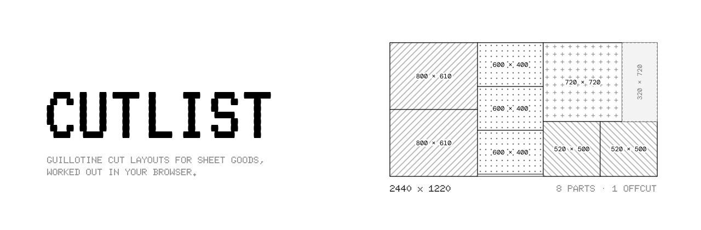

<p align="center">
  
</p>

<p align="center">
  <a href="https://xdgfx.github.io/cutlist/"><b>xdgfx.github.io/cutlist</b></a>
</p>

---

**Cutlist** is a free cut list optimiser for sheet goods. Enter your stock sheets, parts and kerf;
it lays the parts out with guillotine cuts and gives you the cutting order, the waste and the
offcuts worth keeping.

- Everything runs in the browser. Jobs and history are saved in local storage.
- Each run is kept in history and offers several candidates to choose between.
- "Copy link to this job" puts the whole job in the URL.

The terms used here and in the code are defined in [`GLOSSARY.md`](GLOSSARY.md).

## Development

```sh
npm install
npm run dev
npm test
npm run build
```

Every push to `main` deploys to GitHub Pages.
